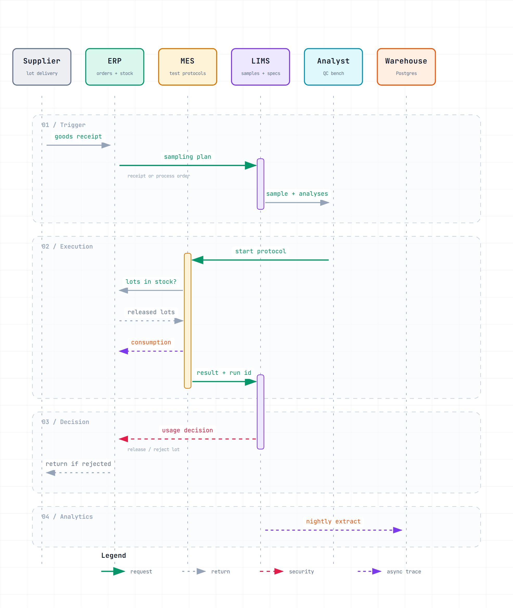
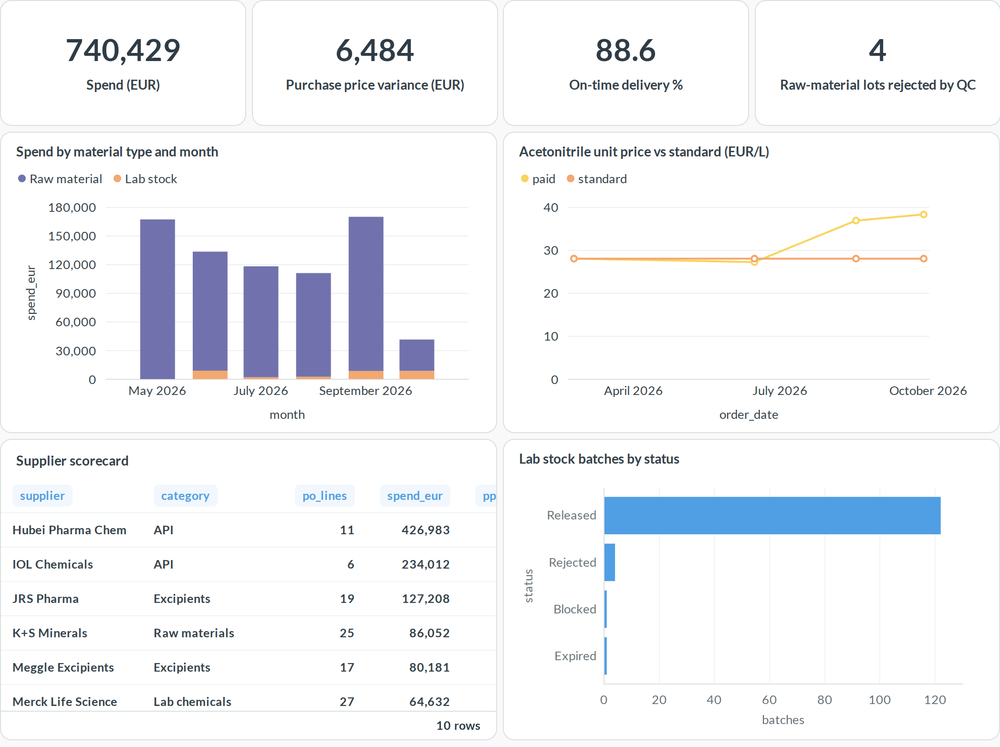
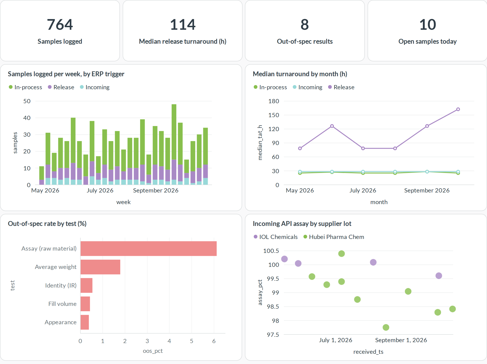
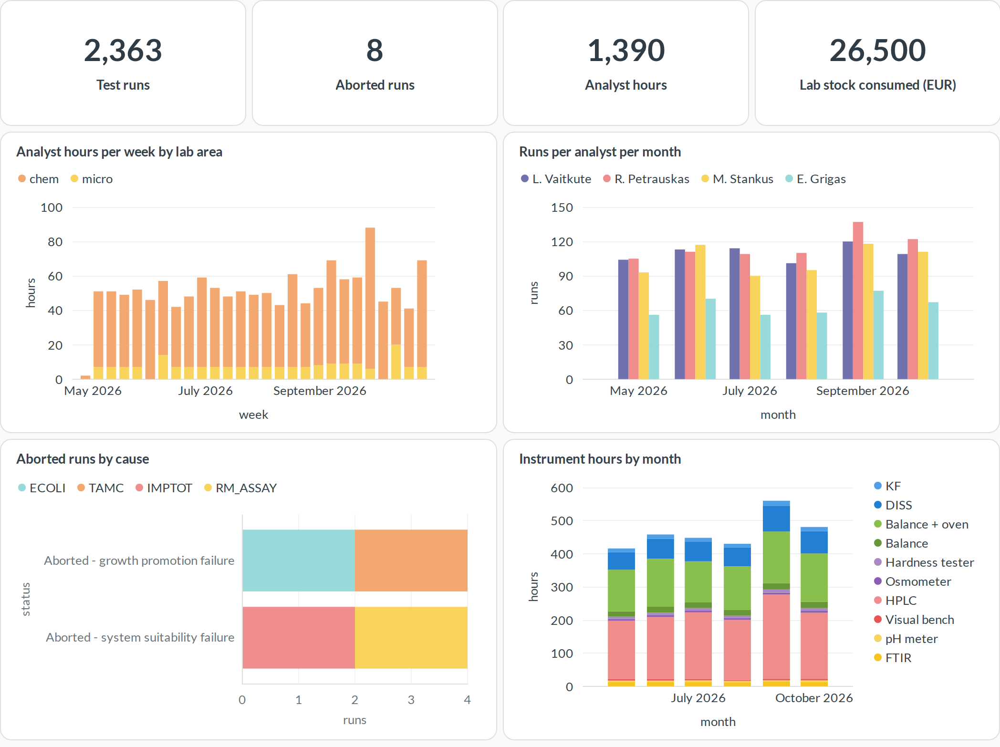
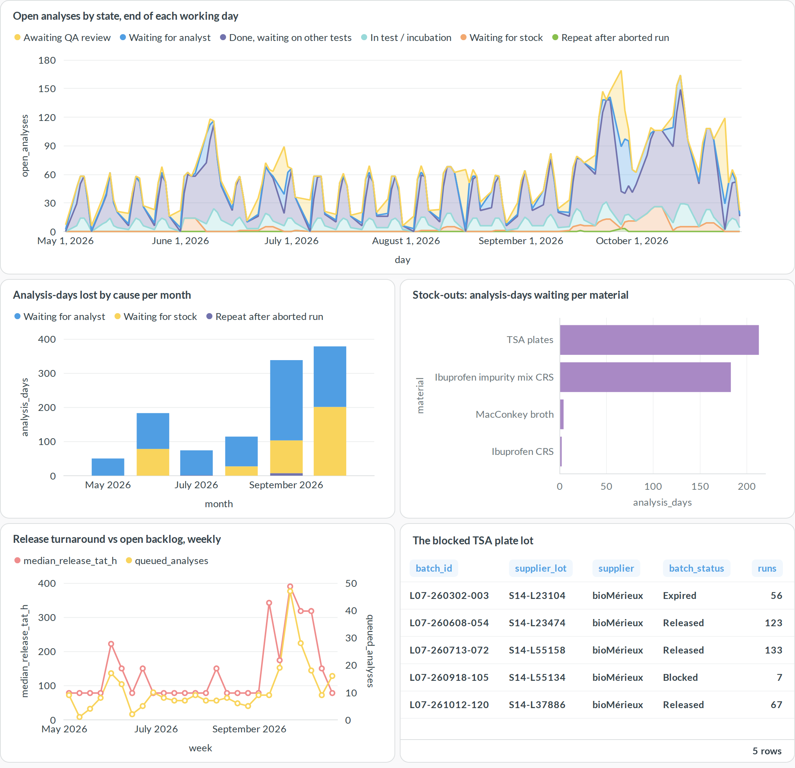
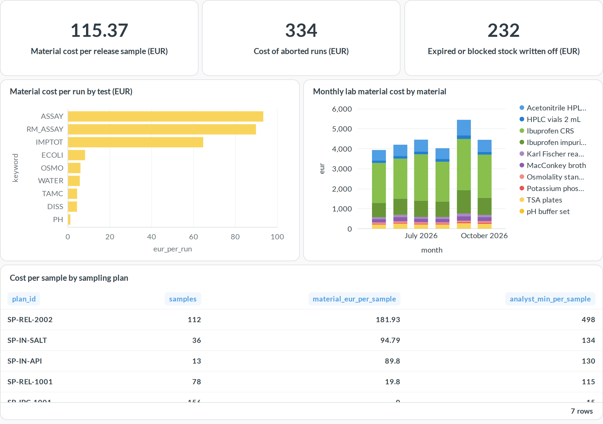

# Lab Ops Analytics

Open-source analytics for a pharmaceutical QC laboratory, joining **ERP**, **LIMS** and **MES** data in one Postgres warehouse, with [Metabase](https://www.metabase.com/) dashboards on top and a live connector for [SENAITE LIMS](https://www.senaite.com/).

The data comes from a day-by-day simulation of how a QC lab actually runs:

- **ERP, role 1: demand.** Goods receipts and process orders fire predefined **sampling plans**.
- **LIMS** logs a sample for each plan line, with **predefined analyses and specifications**.
- **MES** executes each analysis as a **test protocol**. Analyst time comes from a fixed daily capacity, and every run **consumes lab stock lots** (solvents, reference standards, media, vials) from ERP.
- **LIMS, QA review:** the result goes back to LIMS and QA verifies the sample. For an incoming lot, the **usage decision** (release or reject) is posted back to ERP.
- **ERP, role 2: procurement and stock.** Purchase orders, receipts, stock lots, consumption postings, expiry write-offs, and reorder-point purchasing.

Turnaround and backlog are not random numbers. They come out of a first-in-first-out queue worked by real analyst capacity, so demand spikes, stock-outs and failed runs show up as delays.

## Integrations



## Dashboards

### 1 · ERP: procurement & lab stock


### 2 · LIMS: samples & quality


### 3 · MES: test execution


### 4 · Where the lab stalls
Each evening the simulation records where every open analysis is sitting:
- waiting for an analyst
- waiting for stock
- repeating an aborted run
- in test or incubation
- done but waiting on the rest of its sample
- awaiting QA review



### 5 · Cost per test (ERP × MES × LIMS)
Lab stock consumed by each MES run, valued at ERP standard price and rolled up per test, per sampling plan and per sample.


## Stories in the data

The generator (`--seed 42`) plants a few events for the dashboards to surface:

1. **Price rise:** acetonitrile, the HPLC solvent, rises about 35% in price from August. This shows up as purchase price variance (PPV) on lab stock.
2. **Rejected API lots:** ibuprofen API lots from one supplier assay low from mid-July and are rejected at incoming inspection, then returned.
3. **Bad media lot:** one TSA plate lot fails growth promotion in September. The TAMC and E. coli runs that used it are aborted and repeated. After four failures the lot is blocked in ERP, the lab runs short of plates, and release turnaround climbs.
4. **Volume spike:** tablet volume is up 50% in September, so chemistry analysts become the bottleneck.

## Data model

| Schema | Tables |
|---|---|
| `erp` | `suppliers`, `materials`, `purchase_orders`, `goods_receipts`, `stock_batches`, `inventory_movements`, `process_orders`, `sampling_plans` |
| `lims` | `specifications`, `samples`, `analyses`, `daily_wip`, `wait_events` |
| `mes` | `protocols`, `protocol_materials`, `executions`, `consumption` |
| `analytics` | `po_performance`, `sample_tat`, `execution_cost`, `stock_usage` (lot → run → sample genealogy) |

## Run it

Requires Docker and Python 3.10+ (stdlib only, plus Playwright for renders).

```bash
python3 generate/generate.py                      # simulate, writes data/*.csv
echo "MB_ADMIN_PASSWORD=$(openssl rand -hex 12)" > .env
docker compose up -d                              # Postgres loads data/ on first start
set -a; . ./.env; set +a
python3 metabase/provision.py                     # admin user, connection, 5 dashboards
open http://127.0.0.1:3300                        # log in as admin@example.com

pip install playwright && playwright install chromium
python3 metabase/render.py                        # refresh docs/renders/*.png
```

Reload after regenerating: `docker compose exec db psql -U labops -f /warehouse/load.sql`

The integration diagram is built from `docs/diagrams/integrations.sequence.json` with [archify](https://github.com/tt-a1i/archify).

### Optional: SENAITE LIMS

`senaite/setup.py` creates the master data in a SENAITE 2.x site: lab, analysis services, specifications, sample points and client. `senaite/push.py` creates the most recent simulated samples there, with results submitted and verified. `senaite/extract.py` reads samples and analyses back through the JSON API into the same CSV columns as `lims_samples` and `lims_analyses`.

```bash
export SENAITE_URL=http://127.0.0.1:8080/senaite SENAITE_PASSWORD=...
python3 senaite/setup.py && python3 senaite/push.py --days 14 && python3 senaite/extract.py
```

SENAITE accepts backdated sampling and receipt dates. It stamps result capture and verification with the time of the push, so turnaround read back from a seeded SENAITE reflects the push, not the simulated timeline.

## License

GPL-3.0, see [LICENSE](LICENSE).
