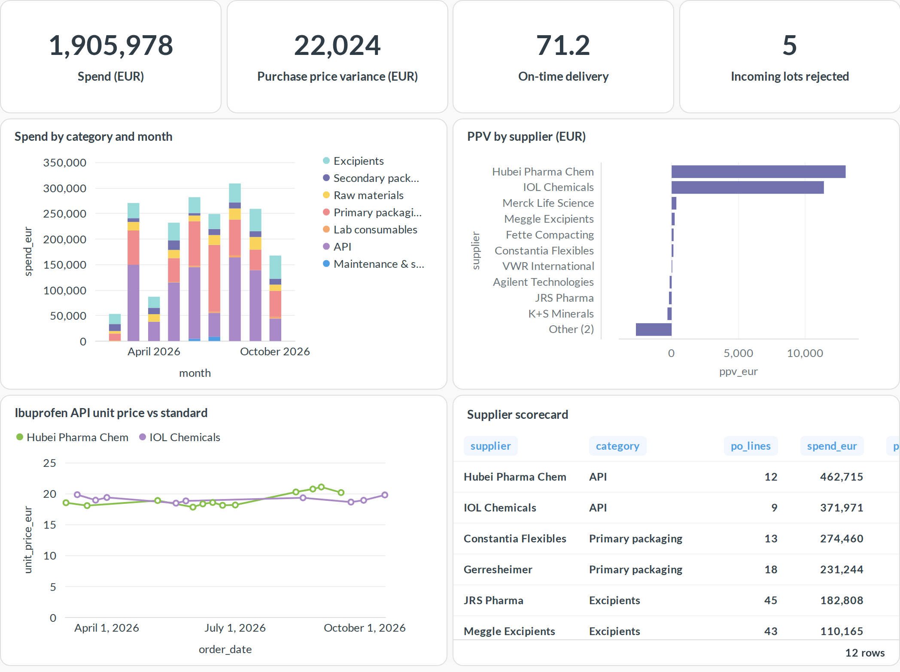
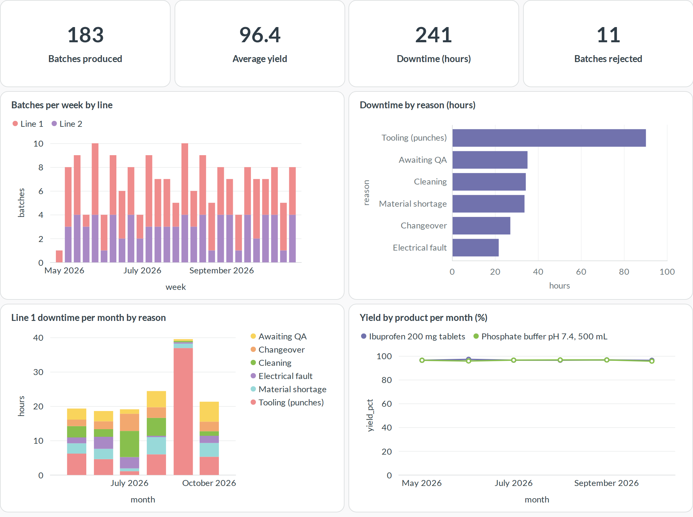
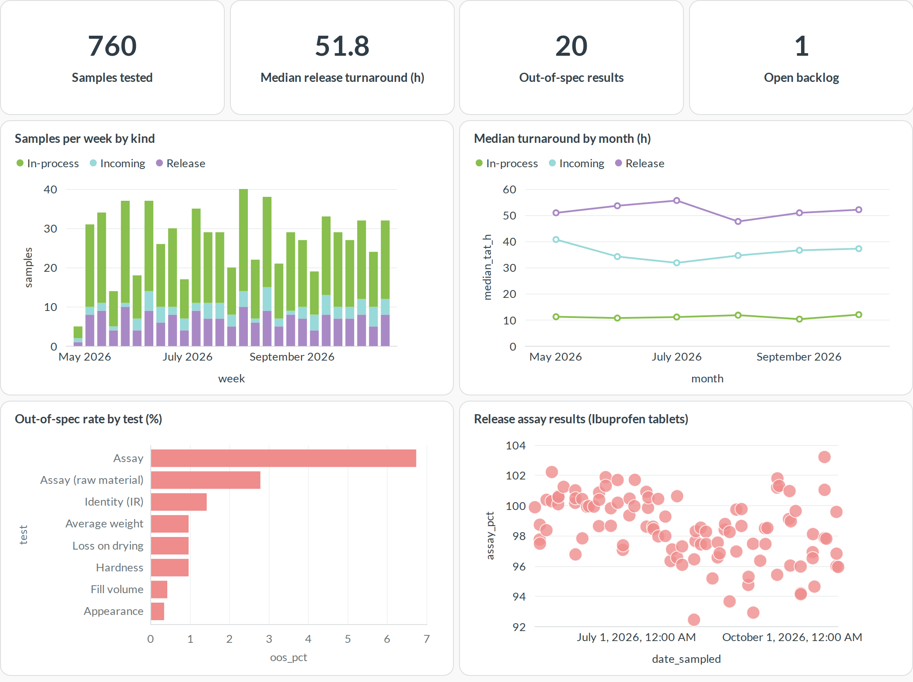
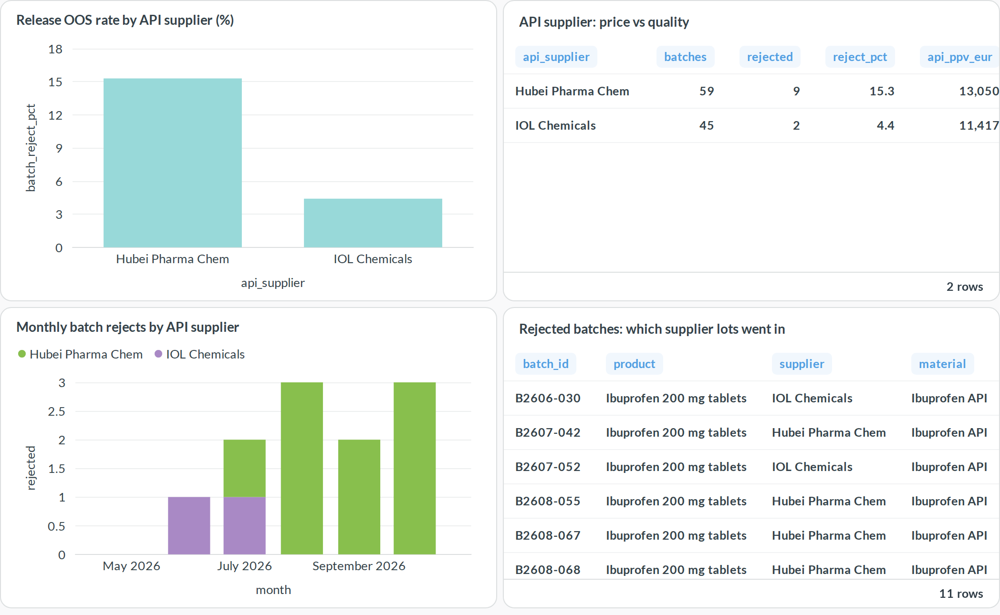
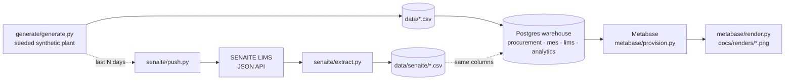

# Lab Ops Analytics

Open-source analytics for a pharmaceutical plant, joining three source systems in one Postgres warehouse with [Metabase](https://www.metabase.com/) dashboards on top:

- **Procurement:** purchase orders, receipts, purchase price variance (PPV), on-time delivery
- **Manufacturing (MES):** batches, yield, material consumption, downtime
- **Quality control (LIMS):** samples, results, out-of-spec, turnaround time, with a live connector for [SENAITE LIMS](https://www.senaite.com/)

The data is synthetic but coherent. A supplier lot on a PO line can be traced to the batches that consumed it and to their release test results, so the dashboards can answer cross-system questions like *"is the cheaper API supplier really cheaper once batch rejects are counted?"*

## Dashboards

### 1 · Procurement


### 2 · Manufacturing (MES)


### 3 · Quality control (LIMS)


### 4 · Supplier → batch → quality


## How it fits together



| Schema | Tables / views |
|---|---|
| `procurement` | `suppliers`, `materials`, `po_lines`, `receipts` |
| `mes` | `batches`, `consumption` (batch ↔ supplier lot genealogy), `downtime` |
| `lims` | `samples`, `results` |
| `analytics` | `po_performance`, `batch_kpis`, `sample_tat`, `lot_genealogy` |

## Stories in the data

The generator (`--seed 42`) plants a few patterns for the dashboards to surface:

1. **Price increase:** the main ibuprofen API supplier raises prices from August, which shows up as PPV.
2. **Quality drift:** its later lots assay lower, so more incoming lots fail and more tablet batches fail release assay.
3. **Downtime:** the Line 1 tablet press has recurring tooling downtime in September.

## Run it

Requires Docker and Python 3.10+ (stdlib only, plus Playwright for renders).

```bash
python3 generate/generate.py                      # writes data/*.csv
echo "MB_ADMIN_PASSWORD=$(openssl rand -hex 12)" > .env
docker compose up -d                              # Postgres loads data/ on first start
set -a; . ./.env; set +a
python3 metabase/provision.py                     # admin user, connection, 4 dashboards
open http://127.0.0.1:3300                        # log in as admin@example.com

pip install playwright && playwright install chromium
python3 metabase/render.py                        # refresh docs/renders/*.png
```

Reload after regenerating: `docker compose exec db psql -U labops -f /warehouse/load.sql`

### Optional: SENAITE LIMS

`senaite/setup.py` creates the master data (lab, analysis services, specs, sample points, client) in a SENAITE 2.x site. `senaite/push.py` then creates the most recent generated samples there, with results submitted and verified. `senaite/extract.py` reads samples and results back out through the JSON API into the same CSV columns.

```bash
export SENAITE_URL=http://127.0.0.1:8080/senaite SENAITE_PASSWORD=...
python3 senaite/setup.py && python3 senaite/push.py --days 14 && python3 senaite/extract.py
```

SENAITE accepts backdated sampling and receipt dates, but stamps result capture and verification with the time of the push. Turnaround read back from a seeded SENAITE therefore reflects the push, not the generated timeline.

## License

GPL-3.0, see [LICENSE](LICENSE).
