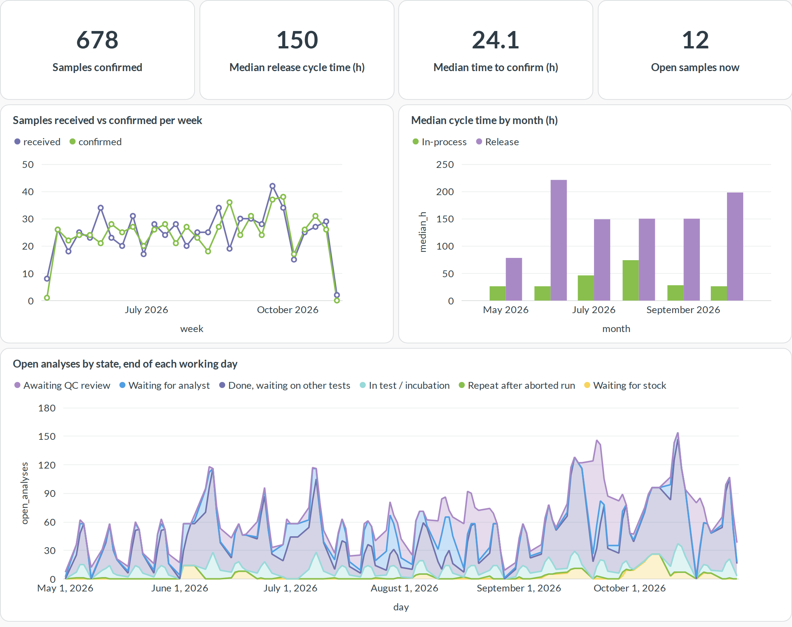
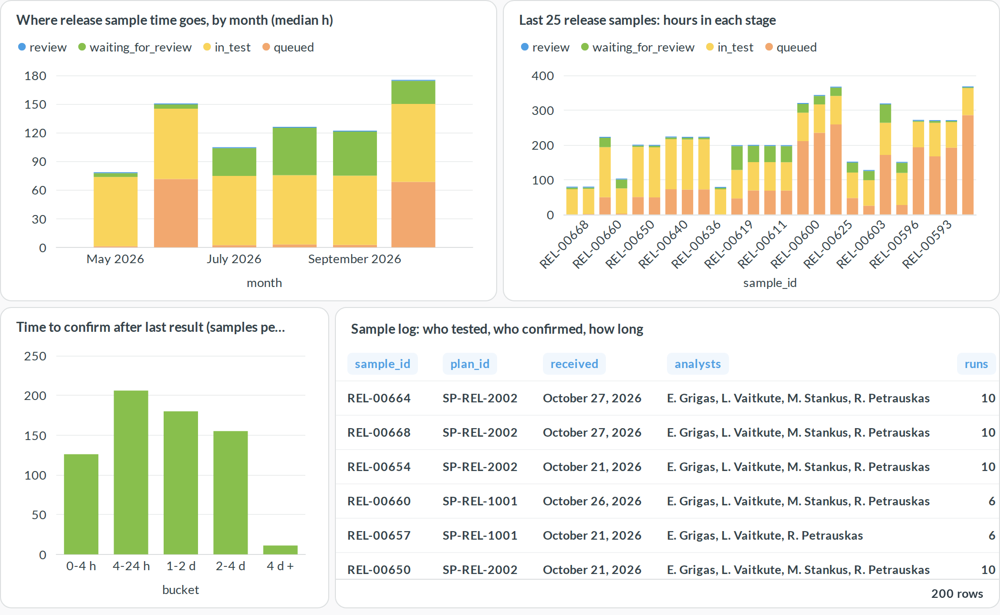
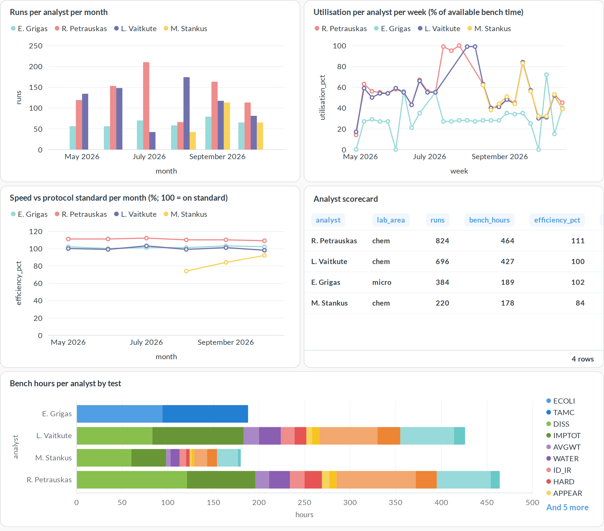
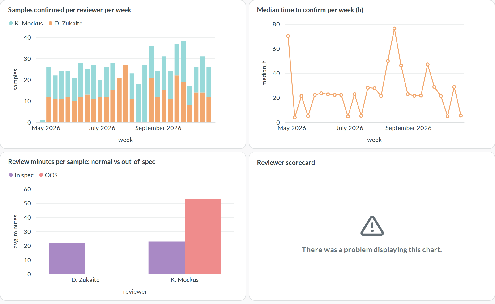
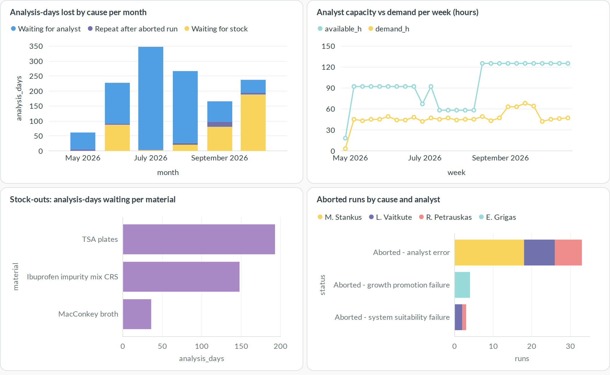

# Lab Ops Analytics

Open-source analytics for a pharmaceutical **QC laboratory**: how many samples get through, how long each one takes to test and confirm, and how each analyst and reviewer is doing. It joins ERP, LIMS ([SENAITE](https://www.senaite.com/)) and MES data in Postgres, with [Metabase](https://www.metabase.com/) dashboards on top.

The data comes from a day-by-day simulation of the lab:

- **ERP planning:** a released process order fires predefined **sampling plans**.
- **LIMS (SENAITE):** QC logs the samples with **predefined analyses and specifications**, then pushes each analysis to MES as a **work order**.
- **MES:** an analyst executes the **test protocol**. Each person has a pace against the protocol standard, an error rate, absences and a daily capacity. The run consumes lab stock lots from ERP inventory, and the result goes back to LIMS.
- **QC review:** reviewers **confirm** samples in LIMS within their daily review time, oldest first. The batch disposition then goes to ERP.

Throughput, cycle time and time-to-confirm are not random numbers. They come out of queues worked by real people with real capacity, so vacations, a new hire, stock-outs and failed runs all show up.

## Integrations


## Dashboards

### 1 · Sample throughput
Samples received vs confirmed per week, cycle time by month, and open work by state at the end of every working day.


### 2 · Every sample: time to test and confirm
Each sample's time split into four stages: queued for an analyst or stock, in test (bench work, instrument runs, micro incubation), waiting for review, and review. Includes the last 25 release samples bar by bar, a histogram of time-to-confirm, and a sample log showing who tested, who confirmed and how long it took.


### 3 · Analysts
Runs, utilisation of available bench time, speed against the protocol standard, first-time-right rate and analyst errors, all per person.


### 4 · QC reviewers: confirming samples
Samples confirmed per reviewer, time to confirm per week, and review minutes for in-spec vs out-of-spec samples.


### 5 · Where the lab stalls
Analysis-days lost by cause, analyst capacity vs demand per week, stock-outs, and aborted runs by cause and analyst.


## Stories in the data

The simulation (`--seed 42`) plants these events:

1. **Summer vacations:** two chemists take holidays (L. Vaitkute in July, R. Petrauskas in August). Capacity drops below demand and the analyst queue builds.
2. **New hire:** M. Stankus starts on 17 August at about 75% of standard pace with a higher error rate, then converges over ten weeks. You can see it in the speed and first-time-right charts.
3. **Reviewer absence:** when one of the two reviewers is away in late July and August, time-to-confirm doubles from about one day to two.
4. **Bad media lot:** a TSA plate lot fails growth promotion in September. Micro runs are aborted, the lot is blocked, plates run short and release samples wait.
5. **Volume spike:** tablet volume is up 50% in September.

## Data model

| Schema | Tables |
|---|---|
| `erp` | `process_orders`, `sampling_plans`, `materials`, `stock_batches`, `inventory_movements` |
| `lims` | `specifications`, `samples` (with review start, reviewer, review minutes, queued and in-test hours), `analyses`, `daily_wip`, `wait_events` |
| `mes` | `protocols`, `protocol_materials`, `executions` (work-order time, analyst, standard vs actual minutes), `consumption` |
| `qc` | `people`, `person_days` (available vs booked minutes per person per day) |
| `analytics` | `sample_cycle` (every sample's stage breakdown), `analyst_runs` (efficiency per run) |

## Run it

Requires Docker and Python 3.10+ (stdlib only, plus Playwright for renders).

```bash
python3 generate/generate.py                      # simulate, writes data/*.csv
echo "MB_ADMIN_PASSWORD=$(openssl rand -hex 12)" > .env
docker compose up -d                              # Postgres loads data/ on first start
set -a; . ./.env; set +a
python3 metabase/provision.py                     # admin user, connection, 5 dashboards
open http://127.0.0.1:3300                        # log in as admin@example.com

pip install playwright && playwright install chromium
python3 metabase/render.py                        # refresh docs/renders/*.png
```

Reload after regenerating: `docker compose exec db psql -U labops -f /warehouse/load.sql`

The integration diagram is built from `docs/diagrams/integrations.sequence.json` with [archify](https://github.com/tt-a1i/archify).

### Optional: SENAITE LIMS

`senaite/setup.py` creates the master data in a SENAITE 2.x site: lab, analysis services, specifications, sample points and client. `senaite/push.py` creates the most recent simulated samples there, with results submitted and verified. `senaite/extract.py` reads samples and analyses back through the JSON API into the same CSV columns as `lims_samples` and `lims_analyses`.

```bash
export SENAITE_URL=http://127.0.0.1:8080/senaite SENAITE_PASSWORD=...
python3 senaite/setup.py && python3 senaite/push.py --days 14 && python3 senaite/extract.py
```

SENAITE accepts backdated sampling and receipt dates. It stamps result capture and verification with the time of the push, so turnaround read back from a seeded SENAITE reflects the push, not the simulated timeline.

## License

GPL-3.0, see [LICENSE](LICENSE).
